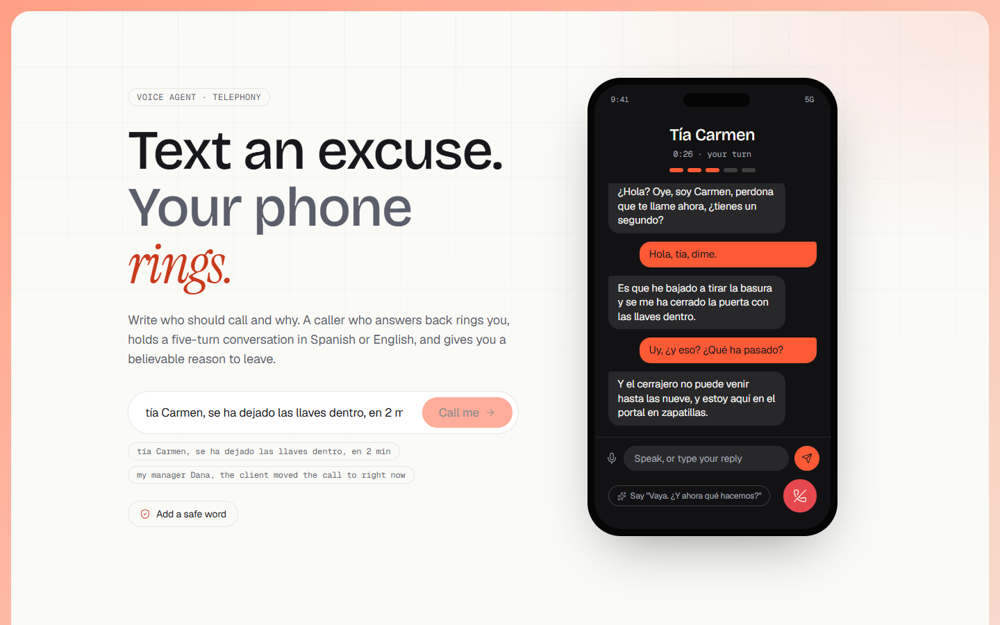
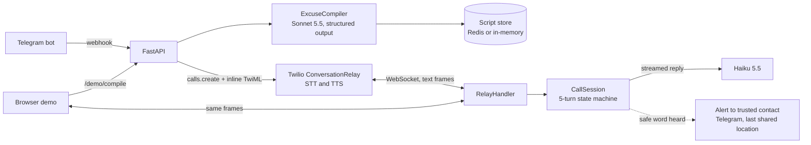

# I'm Busy

Text an excuse. Your phone rings. It's your aunt.



Status: the browser demo, the test suite and the latency harness run with no keys at all, using a scripted caller. `ANTHROPIC_API_KEY` turns the scripted caller into a live one, although I have not yet run the compiler or the caller against the live API, so the prompts are untested on a real model. Real phone calls also need an upgraded Twilio account, a Telegram bot and a public HTTPS URL; that path, including the safe word that alerts a trusted contact, is tested against recorded payloads but has not yet placed a real call or sent a real Telegram message.

If you would rather look than read, [docs/slides/im-busy-walkthrough.pptx](docs/slides/im-busy-walkthrough.pptx) walks through the project in nine slides.

## Why I built this

This project started with a sentence I have heard from a lot of people: "I wish someone had called me right then." In the middle of an uncomfortable situation, a phone call is the most socially acceptable exit there is. I wanted to see how far a voice agent could go in handing people that exit on demand.

## How it works

You send a Telegram bot something like `tía Carmen, se ha dejado las llaves dentro, en 2 min`. One call to Claude Sonnet 5.5 turns that into a call script: who is calling, what happened, what they need from you, two to four small invented details to stay consistent, an urgency level and the first sentence they will say. Code then finishes the script. It clamps the numbers, picks a stock voice from a catalog and checks who the caller turned out to be: a first name or a relationship passes, an organisation or a full name does not. The same rules run on your message before the model sees it, so a request to play your bank or your actual boss is refused without a model call. The model never chooses a voice or a phone number. When the delay is up, Twilio calls the number you shared from your own Telegram account, plays the pre-written greeting the moment you pick up, and from then on streams what you say to my server over a WebSocket as text. A small state machine walks the call through hook, urgency, the ask and the goodbye, rebuilding the prompt each turn with a one-line instruction for that turn, and Claude Haiku 5.5 answers token by token with thinking switched off.



There is one more thing the call listens for. In the bot you can set a safe word with `/safeword pink flamingo`, send one person an invitation link with `/trusted`, and share your location before a risky moment with `/location`. If you say the phrase during a call, the caller does not react to it: the words are cut from what the model sees, the turn gets a single extra instruction to start winding down in the same tone ("my battery is dying"), and the goodbye comes next. Meanwhile the bot sends your contact who, when, your last shared location and a reminder that this is not an emergency service. The match is plain string comparison after removing case, accents and punctuation, with room for one slip of the speech-to-text (two for long phrases), so "pink flamingos" or "pink flaming go" fire and "pink flamenco" does not. I kept the model out of that decision on purpose: it cannot be talked out of it, and it costs nothing per turn.

The browser demo is the same loop with the phone taken out. The page plays Twilio's role: it sends the same `prompt` and `interrupt` frames over `/demo/ws`, speaks the `text` tokens with the Web Speech API and listens with the browser's speech recognition. Because of that, the demo exercises the real `RelayHandler` and `CallSession` rather than a mock of them, and the tests do the same with an in-memory transport. The demo also has a Safe word panel: set a phrase, optionally let the browser share your position, say the phrase mid-call, and the page shows the exact message your contact would get, marked as a demo that sends nothing.

## Running it

You need Python 3.12 with [uv](https://docs.astral.sh/uv/) and Node 20.19 or newer. These are the commands I run:

```bash
uv sync
uv run poe web-build      # npm ci + vite build into web/dist
uv run poe serve          # http://localhost:8000, the demo page and its API
uv run poe test           # 275 tests, no network, no keys
uv run imbusy talk "tía Carmen, se ha dejado las llaves dentro"   # the same call in a terminal
```

Without a key the caller follows a script and ignores what you say, and the page says so. Copy `.env.example` to `.env` and set `ANTHROPIC_API_KEY` for a live caller. Chrome gives you the spoken version; other browsers fall back to typing your side of the call, because `SpeechRecognition` is still Chrome-first. Setting up Twilio, Telegram and a tunnel for real calls is a longer story, and [docs/providers.md](docs/providers.md) tells it console page by console page, including the fact that Twilio's free trial blocks ConversationRelay outright.

## What I measure

The number that matters for a voice agent is the silence between the end of your sentence and the first word of the reply. My server can only see part of it, from the final transcript to the first token it sends back, so I report that separately from what the browser and the phone actually experience.

None of these numbers has been measured yet, because they need a model key and, for the last ones, a browser and a phone. `uv run poe eval` will measure the server-side gap from the final transcript to the first token sent, as p50 and p95 for Spanish and English, against the real fast model. The demo page reports the browser's own gap, from the end of your speech to the first synthesized audio, in `metric` frames that the server logs at the end of each demo call. `uv run poe eval-golden` runs the compiler against the 24 cases in `evals/golden/excuses.yaml`, 14 of which it must decline. A real phone call has not been placed yet either.

`uv run poe eval-fixture` runs the same harness against a fake model with a 120 ms first token, which is how I know the harness itself adds about 20 to 30 ms.

## Decisions, and what I tried first

The greeting is written by the compiler before the phone rings and handed to Twilio as `welcomeGreeting`. Generating it live would have been simpler to code, but it puts a model round trip at exactly the moment a silence is most suspicious: when you pick up and say "¿sí?".

I split the work between two models instead of using one everywhere. Sonnet runs once per excuse, where a few seconds are fine and quality decides whether the story holds up. Haiku runs on every turn, where the time to first token is the product, and on Haiku I can turn thinking off entirely; Sonnet 5.5 rejects that setting.

The call is a state machine rather than an open chat. An open chat would need the model to decide when the call is over, and a caller who never hangs up is worse than no caller. Five states with a one-sentence directive each ("this is your last turn: say goodbye in under 12 words") keep the call short and make it land on a reason to leave.

Phone verification is Telegram's own `request_contact` button, accepted only when the shared contact's `user_id` is the sender's. I had planned an SMS one-time code, then found that Twilio trial accounts cannot send custom SMS text, and that Telegram has already verified that number by SMS anyway. There is no code path that accepts a destination number at all.

The trusted contact joins through a `t.me` link they open themselves rather than by me typing in their number. Telegram bots cannot write to someone who has never started them, so the contact's own tap is both their consent and the thing that lets the bot reach them; asking for a phone number would have been one tap shorter and would not have worked. Their location never goes to the database: it sits in Redis with an expiry of an hour by default, or in process memory when there is no Redis, and `/forgetlocation` drops it at once.

For streaming I hold back one token so the final frame can carry `last: true`, because ConversationRelay requires a non-null token and I did not want to bet on an empty one being accepted. It costs one inter-token gap per turn. I also wait for the farewell to finish playing before sending `end`, because Twilio's docs do not say whether `end` lets queued speech finish.

## Where this sits

Fake-call apps are an old idea, and some now use AI voices: [ExitCall](https://apps.apple.com/app/exitcall/id6763378665) rings your iPhone through CallKit with an AI caller that can reply, and [ComfortCall](https://www.producthunt.com/posts/comfortcall) places a real call to your number and, going by its own description, follows a guided script. Voice-agent platforms such as Vapi and Retell sell the telephony and turn-taking layer as a service. I'm Busy is a smaller, open take on the same idea, built directly on Twilio ConversationRelay, with the call script, the turn structure and the safety rules out in the open where you can read and change them.

## Responsible use

The tool takes a name and an excuse, and that is all it will play. It refuses, in code before any model is asked and again on what the model returns, to sound like an identifiable real person, to play the police, a bank, a hospital, a government office or any company, to call or deceive anyone but the person asking, or to touch money, codes and passwords; the cases it must refuse and the generic ones it must let through are pinned in the tests and the golden set. Calls only ever go to your own verified number, the voices are stock voices with no cloning, and there is a daily cap. The bot and the demo page say this in two lines before your first call, and [RESPONSIBLE_USE.md](RESPONSIBLE_USE.md) has the whole policy and how to report misuse. The checks are phrase lists and a full-name pattern, so they will refuse the odd harmless request and they cannot catch everything; the prompt covers the rest, and I would rather hear about a gap than find it.

## Limits, and what running it for real would take

It handles Spanish from Spain and American English, with stock voices only. The caller only knows what the compiler invented, so a sharp question can still catch it out, and Telegram does not report a user's timezone, so "a las 18:30" is read in `DEFAULT_TIMEZONE`. Calls ring from a US number unless you buy a local one, which in Spain needs identity and address documents. Scheduled calls live in process memory and a restart drops the ones that have not rung yet. The barge-in in the demo is typed, not spoken, because laptop speakers bleed into the microphone. The safe word is not an emergency service and the bot says so when you set it up and in every alert: it sends one Telegram message to one person, only if the call is connected and the transcription catches the phrase, with whatever location you last chose to share. It works over the phone and in the demo through the same session code, but the offline preview of the page, which has no server, skips it.

I have not deployed it. For many users the WebSocket is the constraint: every live call holds one open socket to whichever instance Twilio reached, so I would run a few always-on containers on Fly.io or Cloud Run with session affinity, in a region close to Twilio's edge for Spain, and keep scripts and call state in a managed Redis so any instance can answer the relay connection. The in-process scheduler would become a delayed queue. At list prices a 90-second call to a Spanish mobile costs about 40 cents in Twilio charges against well under a cent of model tokens, so the per-user daily cap is a billing control as much as an abuse control. Next on my list are saved excuses ("the usual"), calls scheduled for a clock time, and telling you after the call that your contact was alerted, which today the bot deliberately does not do while the call might still be on screen.

## Thanks

I learned to program thanks to other people: the ones who reviewed my pull requests line by line, and the giants of this craft whose work I read and build on. So criticism and feedback are always welcome here. If you have read this far, thank you. Sharing code in the open and growing together is a pleasure.

MIT licence, see [LICENSE](LICENSE).
